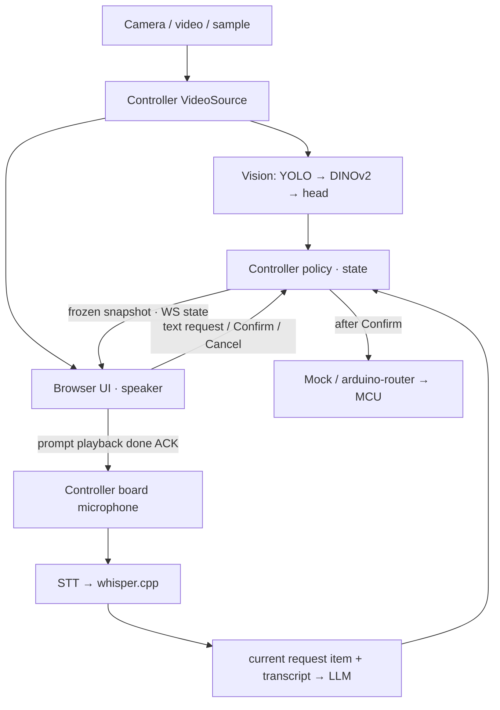

# Architecture and execution paths

The implementation is the source of truth; this document points to the entry points. See [`common/config.py`](../common/config.py) for settings, [`common/contracts.py`](../common/contracts.py) for types, and [`app/server.py`](../app/server.py) plus each service's `server.py` for HTTP routes.

## Request flow

1. [`media.py`](../app/media.py) captures a single input. A manual observation, or the stability check in [`capture.py`](../app/capture.py), freezes the image and its Vision result. Bboxes are drawn on this snapshot.
2. [`controller.py`](../app/controller.py) picks the target by confidence and fill level. Scenes with enough drink left or with uncertain results are skipped. Policy thresholds come from settings.
3. When the tablet finishes the fixed WAV prompt and ACKs with the current session/scene/object/sequence, the board records. The STT transcript is passed to the LLM automatically. With development browser recording, the user reviews the transcript and then presses Send.
4. [`language.py`](../app/language.py) sends an English system prompt and `{current_request: {item}, utterance}`. Images, the full Vision result, and conversation history are not sent to the LLM. The first item comes from the observed target; corrections come from the current card.
5. The LLM returns `refill/decline/cancel/not_understood` and an item. Only refill creates a card; if the request is not understood, the user is asked to try again. Nothing is loaded or returned before an explicit Confirm on the card.

The Controller uses a lock, a generation token, and a card revision to block duplicate confirmations and late results that arrive after a cancel. The UI ignores stale state by instance_id/sequence and receives the full state when the WS reconnects. Sessions live in memory only. Auto-capture progress events use a separate revision and do not change the request sequence.

## Model execution

| Service | Actual path | Lifetime |
| --- | --- | --- |
| Board LLM | Qwen API → `BoardLLMBackend` → Gemma4 `qnn_llm_runner_host` | Preloaded at server start, same model worker reused, KV reset per request |
| Vision | external factory → `VisionBackend` → YOLO/DINO runner → head | Models load at startup. The CLI bundle uses a resident native worker for each |
| STT | external factory → `WhisperHTTP` → external whisper.cpp | Adapter lives as long as the service; the model server is managed separately |
| Dev LLM | Controller or Qwen proxy → Mac MLX HTTP | Owned by the remote server |

`QWEN_*` is the existing service boundary name; the actual model on the board is Gemma4. `qwen_cli` is a one-shot Qwen runner that must be selected separately. There is no automatic fallback when a model fails. An LLM worker error can be recovered by reloading on the next generation request; a Vision worker error is recovered by restarting the service.

The app is native Python/venv/FastAPI with one Uvicorn worker per service. The training/export environment is kept separate in `ml/`. Board execution and process ownership follow the [runbook](BOARD_RUNBOOK.md); connection rules follow the [contracts](CONTRACTS.md).

## Vision categories and request menu

The existing DINO softmax output is summed into `coffee + coke → coke` and `water → water`.
The representative name `coke` is an observation group; it does not mean the drink was identified as coffee. Fill-level calculation and model weights are unchanged.
The Controller expands every group recognized in the frozen scene into the requestable `allowed_items`.
Example: only coke visible gives coke/coffee, only water gives water, both give water/coke/coffee.
This list is passed to the LLM product prompt, and the Controller returns any LLM
request outside the list to the re-confirmation state, blocking confirmation. Confirm is still required separately.
Demo tools show the fixed mapping as read-only. The implementation source is `common/vision_categories.py`.

**Enable untrained drink variants (demo only)** in Demo tools is OFF by default.
When on, it expands only the request menu: water → water/sparkling water/soda, coke → coke/coke zero/coffee.
It does not change the Vision training classes, probabilities, or model; the extra drinks are selected by the customer's utterance.
API identifiers are `sparkling_water` and `coke_zero`; the English UI shows them with spaces.
The toggle is kept in Controller memory, so it is shared across tablet reconnects, and it returns to OFF when the server restarts.
Changing it discards the request card and requires re-confirmation; changes are rejected while inference, recording, or a sequence is in progress.
