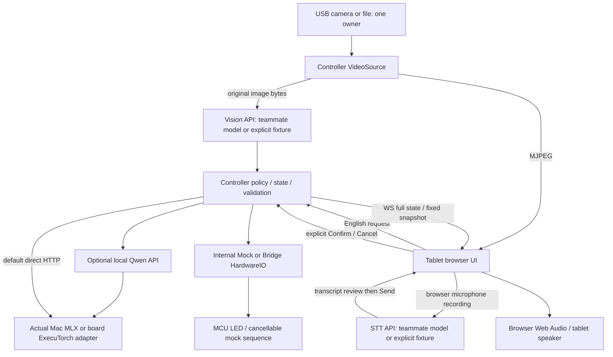

# Refill Assist — Architecture

기준 2026-10-16. 사용자 확정 지시를 반영한 구현 문서다. [실제 실행](../README.md), [API 계약](CONTRACTS.md), [시각적 설명](architecture.html). 과거 Design Doc보다 우선한다. 설명 HTML과 실제 앱 UI는 별개다.

## 제품·범위

4명이 Arduino VENTUNO Q 한 대를 사용한다. 여러 컵·접시 검출→객체별 crop→DINOv2 종류·잔량 판단은 **Vision 팀원 소유**. 우리 구현은 원본 이미지 입력·객체 결과 계약·검증·fixture·adapter·timeout/readiness이며 검출/crop/모델 전후처리를 구현하지 않는다. STT 모델·오디오 전처리도 담당자 소유다. 주요 음료 water/coke/coffee, 요청 분량 small/regular. 모델 내부 라벨/출력 해석은 담당자가 adapter에서 변환한다.

요청 해석 Qwen3-0.6B 유지. 앱은 현재 요청+새 영어 발화를 전달하고 strict JSON·허용 메뉴·분량을 검사한다. 관측 음료와 고객 요청은 별개. 충분한 잔량·불확실 판단은 skip. 고객 입력→수정 카드→**명시 Confirm** 전에는 시퀀스를 시작하지 않는다. 실제 주행/집기 없음.

## 구성·소유

**변경된 카메라 소유 책임:** 이전 문서의 Vision 서버 camera owner를 Controller VideoSource로 이동했다. 서비스 레이어가 원본 bytes를 전달하고 모델 담당자가 카메라까지 중복 구현하지 않도록 한 선택이다. detector/crop 구현 변경이 아니다. bbox는 분석 시 snapshot 위에만 표시하고 live preview에는 오래된 box를 겹치지 않는다. 요청 카드는 같은 frozen frame의 대상 부분을 CSS로 표시하며 모델 crop 코드가 아니다.

태블릿 브라우저가 마이크·스피커를 모두 소유한다. MediaRecorder→Controller→STT, 전사 검토→Send. 서버 장치 오디오 없음. Start demo에서 AudioContext를 활성화하고 고정 WAV 안내를 재생한다. 실제 TTS 없음. [HTTPS/권한/현장 점검](TABLET_DEMO.md).

## 실행 위치

| 구성 | 개인 개발 | 보드 |
| --- | --- | --- |
| Controller/UI | 개발자 노트북, UI는 태블릿 또는 로컬 브라우저 | Ubuntu, 태블릿 HTTPS 접속 |
| Qwen | 실제 Mac mini HTTP; 선택 우리 proxy 또는 명시 fixture | localhost API + 미연결 ExecuTorch adapter |
| Vision/STT | fixture 또는 담당자 async backend/HTTP 서버 | localhost API + 담당자 실제 모델 |
| HardwareIO | 상태 mock | 명시 Bridge 선택 후 MCU mock sequence |
| Mic/speaker | 브라우저 | 태블릿 브라우저 |

FastAPI+Uvicorn, 서버별 worker1, ROS/앱 Docker 없음. 학습·export Docker는 ml/ 별도. 기본 포트 Controller8080, Qwen8000, Vision8001, STT8002; 모두 localhost. 태블릿은 Tailscale Serve HTTPS→Controller. raw IP 화면만 필요할 때 CONTROLLER_HOST를 설정할 수 있지만 마이크에는 HTTPS 필요.

## 제품 로직과 모델 서버

- app/language.py: 제품 영어 프롬프트·현재 요청+발화·파싱·허용값. generic Qwen 서버가 제품 정책을 소유하지 않는다.
- services/qwen: model/messages/생성 옵션 검증, admitted queue4/동시1, 전체20초 timeout, MLX/fixture/ExecuTorch 경계. 실패 시 fixture 전환 없음.
- Mac 실제 `/v1/models`로 ID 확인, `/v1/chat/completions`로 생성. `mlx-community/Qwen3-0.6B-4bit`, temperature0, thinking false 요청. 서버 설정·모델 변경 없음.
- Vision/STT API는 담당자 async factory 또는 HTTP 연결. 신뢰도/bbox/전사 fixture는 항상 fixture로 표시한다. 내부 tensor, preprocessing, label 정의는 추측하지 않는다.
- ExecuTorch는 HTTP 서버가 아니다. 제공 qnn_llama_runner/qnn_executor_runner CLI의 상주 실행·수명·Python 지원은 실제 보드 확인 후 연결한다. HTTP 상주가 모델 상주를 보장하지 않는다.

## 로컬·보드 모델 연결 가이드

개발자와 코딩 AI는 [models/README.md](../models/README.md)의 배치·설정·담당자 경계를 따른다. 모델 파일은 `models/local/{vision,stt,qwen}/` 또는 `models/board/{vision,stt,qwen}/`에 두고, 실제 runtime에 맞는 backend와 경로를 명시적으로 선택한다. 개인 `.env`와 `.env.board`/process env로 구분하며 Controller에는 API URL만 전달한다.

연결 시 필요한 `VISION_MODEL_PATH`, `STT_MODEL_PATH`, `QWEN_MODEL_PATH`, `QWEN_TOKENIZER_PATH`만 공통 설정과 해당 backend에 추가한다. **현재는 이 경로를 읽는 공통 로더/서비스 연결이 구현되지 않았다.** `mlx` backend도 기존 서버를 호출하는 HTTP client다. 파일 검색·자동 runtime 선택·복잡한 registry를 미리 만들지 않고, 담당자가 구체적인 모델을 연결할 때 최소한으로 구현한다. Vision/STT의 기존 async factory/API 계약과 모델 담당자의 전처리 소유권은 유지한다.

## 상태·동시성

관찰→정책→offered→고객 입력→interpreting→card→Confirm→loading→returning→done. 충분/불확실 skipped, 거절 declined, 취소 cancelled, 모호 clarify, 대기60초 expired, 오류 error→입력 재시도/새 관찰. 대상은 낮은 fill_ratio의 신뢰할 수 있는 객체, 정책값은 설정 가능하고 보드 실측 기준은 아니다.

scene_id/object_id/request_id/revision을 검증한다. 제안 자체는 confirm 불가. 수정된 카드에는 새 revision이 필요하고 중복/오래된 확인409. 모든 background 작업에 generation token을 부여해 Cancel/새 장면 후 늦은 응답을 무효화한다. 추론은 비동기 task로 실행해 상태·취소가 응답한다. native 팀원 backend도 event loop를 막지 않아야 한다.

HTTP는 입력/확인, WS는 전체 상태 snapshot+sequence/heartbeat, 영상 MJPEG, MCU는 내부 HardwareIO→공식 Bridge. WS 재연결 시 최신 상태. 초기 데모는 단일 세션이며 영속 저장/다중 테이블/연속 객체 tracking은 구현하지 않는다.

## 운영·분업

개발자는 각자 venv와 로컬 앱, 기본 Vision/STT fixture+Mac API로 개발한다. direct 모드는 Controller만 시작, proxy 모드는 우리 Qwen API 포함, integration은4서버. [실행 도구](../scripts/README.md). Ctrl+C 또는 --stop으로 관리 프로세스 정리. 보드 통합 checkout 한 개·배포 담당 한 명, camera/MCU 중복 점유 금지.

fixture 모드는 Vision/STT fixture와 Hardware mock을 강제하고 Qwen은 설정한 실제 HTTP API를 사용한다. 완전 오프라인 재현/자동 테스트는 별도 offline 모드로 Qwen까지 fixture로 고정한다. 두 모드 모두 로컬 Qwen 서버를 추가로 시작하지 않는다.

.env(개인)/.env.board(공유) 선택, process env 우선, 설정 범위 검증. model/data/log/generated 결과 Git 제외. 기존 Qwen 평가 아카이브 보존, 새 음료 평가 timestamp 파일. 실제 Mac/fixture 테스트와 보드 NPU/장치 실측은 구분한다.

## 보드에서 남은 검증

[보드 runbook](BOARD_RUNBOOK.md), [대회 IoT guide](../qc-executorch-guide/IoT/README.md), [artifact inventory](../qc-executorch-guide/IoT/artifacts/README.md)를 따른다. QCS8275 Linux+STM32H5F5, 제공 ExecuTorch/QNN checkout·SDK/bundle 경로를 설정한다. 모델 상주 실행·메모리·지연·NPU delegation과 CPU 비교를 추측하지 않는다. DINO 제공 예제가 ImageNet classification logits일 수 있으므로 embedding으로 가정하지 않는다. GPIO pin/polarity·센서 확보 여부도 현장 확인한다. MCU는 provide_safe/짧은 handler/nested RPC 금지/nonblocking 취소/watchdog를 적용한 **미검증 초안**이다.
