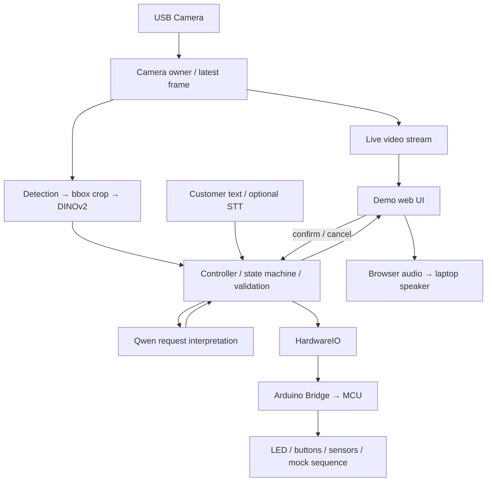

# Refill Assist — Architecture

처음 읽는다면 [그림으로 보는 아키텍처](architecture.html)에서 컵 장면·모델 입출력·실행 위치를 먼저 살펴본다. HTML은 브라우저에서 직접 열 수 있으며 별도 서버나 모델 연결이 필요 없다.

기준일: 2026-10-16. 이 문서는 팀이 합의한 구현 방향이다. 기존 [Design Doc](<Design Doc.md>)보다 이 문서의 결정을 우선한다. 아래 구조는 목표 아키텍처이며 구현 완료를 의미하지 않는다.

## 제품과 범위

4명이 Arduino VENTUNO Q 한 대로 개발한다. 여러 컵·접시가 보이는 카메라 장면에서 객체를 검출하고, bounding box별 이미지를 잘라 종류와 잔량을 판단한다. 메인 데모는 **water / coke / coffee** 컵이다. 최종 잔량 라벨과 검출 모델은 미정이다.

잔량이 부족한 컵에 리필을 제안하고, 고객의 요청·수정을 해석해 요청 카드로 보여준다. 고객이 명시적으로 확인한 뒤 적재·주방 복귀를 mock으로 표현한다. 충분한 잔량 또는 불확실한 인식에는 제안하지 않는다. 실제 자율주행·로봇팔 집기는 범위 밖이다. 제품 UI·안내·프롬프트·고객 발화는 영어로 한다.

## 확정한 기술 방향

- ROS 없이 중앙 Controller와 필요한 API로 구성한다.
- 비전 baseline은 **DINOv2**, 요청 해석은 **Qwen3-0.6B**를 유지한다. 사용자가 직접 시험한 정확도를 바탕으로 선택했다. 기존 평가 보고서는 당시 환경의 기록으로 보존한다.
- 보드 Linux는 Qualcomm Dragonwing IQ8 / QCS8275에서 ExecuTorch를 실행한다. NPU 사용 여부는 delegation·profiling 확인 후 주장한다.
- STM32H5F5 MCU는 Arduino Bridge를 통해 LED·버튼·센서·mock 시퀀스를 담당한다.
- 개발 중 앱은 각자 로컬에서 실행하고, 공용 Qwen은 `http://won-macmini:8000`을 사용한다. 모든 기기는 Tailscale로 연결되어 있다.
- 서버는 **Python FastAPI + Uvicorn**으로 구성한다. ExecuTorch는 HTTP 서버가 아니라 모델 실행을 담당한다.
- 보드에서는 모델 API 서버와 Controller를 별도 프로세스로 실행하고 localhost로 연결한다. **Docker 없이 보드 Ubuntu에서 직접 실행 + Python 가상환경 + 시작·종료 스크립트**를 초기 배포 방식으로 선택한다.

## 전체 구성



## 모듈 책임

| 모듈 | 책임 |
| --- | --- |
| Camera | 카메라를 단독 소유하고 최신 프레임을 영상 전송과 Vision에 제공 |
| Vision | 여러 객체 검출, crop, DINOv2 기반 종류·잔량 판단, 객체별 결과 반환 |
| Language | 현재 요청과 새 발화를 Qwen에 전달하고 구조화된 요청 초안 반환 |
| Controller | 대상 선택, 정책, 요청 검증, 확인·취소·timeout, 상태와 동작 명령의 단일 소유자 |
| HardwareIO | mock 로그 또는 실제 Bridge 호출로 LED·버튼·센서·시퀀스 처리. 별도 HTTP 서버가 아닌 내부 모듈 |
| Demo UI | 라이브 영상·bbox·종류·잔량·대화·요청 카드·확인/취소·상태 표시와 오디오 재생 |

Qwen 결과만으로 MCU 동작을 승인하지 않는다. 메뉴·분량·schema는 코드로 검사하고 고객 확인은 Controller에서 처리한다. 비전 관측과 고객 요청은 별개 데이터로 유지한다.

## 실행 위치와 통신

| 구성 요소 | 개인 개발 | 보드 통합 |
| --- | --- | --- |
| Controller / UI / 정책 | 각자 노트북 | 보드 Linux, UI는 노트북 브라우저에서 접속 |
| Qwen | Mac mini 공용 API 또는 fixture | 보드 ExecuTorch API 서버 |
| Vision | 담당자 로컬 또는 fixture; 필요하면 공용 API | 보드 카메라·검출·DINO API 서버 |
| HardwareIO | mock | Arduino Bridge |
| 화면·스피커 | 노트북 | 발표 노트북 및 선택적 외장 스피커 |

Controller의 외부 입력은 HTTP, UI 상태 이벤트는 WebSocket을 사용할 계획이다. 보드 내부 모델 호출은 localhost HTTP, MCU 호출은 Arduino Bridge로 한다. 같은 프로세스의 모듈은 함수·queue로 연결하며 전부 서버로 분리하지 않는다. 실제 경로와 payload schema는 구현 전 고정한다.

기본 포트 계약:

| 서비스 | bind | 포트 |
| --- | --- | --- |
| Controller / UI | `0.0.0.0` — 팀은 보드 Tailscale 주소로 접속 | 8080 |
| Qwen | `127.0.0.1` | 8000 |
| Vision | `127.0.0.1` | 8001 |

모델 서버는 가능하면 시작 시 모델을 로드하고 재사용한다. 제공 ExecuTorch runner가 일회성 CLI인지, 지속 실행이 가능한지는 확인이 필요하다. Mac MLX와 보드 ExecuTorch의 출력·속도 동등성을 가정하지 않는다.

## 서버와 모델 실행의 경계

FastAPI는 API·입력 검증·응답·WebSocket을 정의하고, Uvicorn이 포트를 열어 요청을 처리한다. 보드의 모델 실행은 API handler에서 모델 adapter를 통해 ExecuTorch에 전달한다. Mac mini의 기존 MLX 서버는 개발용 외부 API이며 FastAPI로 다시 만들 필요가 없다.

```text
Controller → HTTP → FastAPI 모델 서버
                       → 전처리 / 프롬프트 구성
                       → ModelBackend → ExecuTorch 모델 실행
                       → 후처리 / JSON 응답
```

서버 코드와 API 계약은 로컬에서 개발할 수 있다. 모델 실행 부분은 로컬 mock backend로 대체하고 보드에서는 ExecuTorch backend를 연결한다. 이는 Controller가 Vision을 호출하는지 정하는 `VISION_BACKEND=fixture/http`와 별개다. 예를 들어 Vision 서버 자체를 개발할 때도 HTTP endpoint 뒤의 모델만 mock으로 둘 수 있다. 내부 model backend 선택 설정과 실제 Python 클래스·모듈명은 구현 시 정한다.

대회 가이드의 `qnn_executor_runner`·`qnn_llama_runner`는 실행 파일이다. 지원되는 Python API 또는 지속 실행 인터페이스가 있는지 보드에서 확인한다. 초기 연결은 subprocess로 제공 runner를 호출할 수 있지만, 일회성 runner를 매 요청마다 실행하면 모델 로딩도 반복될 수 있다. HTTP 서버가 상주한다는 사실만으로 모델 상주 실행이 구현되지는 않는다.

초기 모델 서버는 Uvicorn worker 1개를 기준으로 한다. 추론은 worker/queue 등으로 요청 처리와 분리해 긴 추론 중에도 영상·상태·취소가 응답하도록 한다. HTTP worker 수를 늘려 모델·카메라를 중복 생성하지 않는다. 성능은 API 대기·전처리·추론을 나눠 실제 보드에서 측정한다.

## 로컬 실행과 보드 배포 계획

아래 실행 도구는 **구현 예정**이다. 아직 파일이 없으므로 지금 실행할 수 있는 명령이 아니다.

| 실행 도구 계획 | 역할 |
| --- | --- |
| `python scripts/dev.py` | `.env`를 읽어 필요한 로컬 프로세스만 시작. 기본은 Controller/UI 하나. 선택한 로컬 Vision 통합 시 Vision 서버 추가. 공용 Mac Qwen은 시작하지 않음. Ctrl+C로 시작한 자식 프로세스 함께 종료 |
| `scripts/start-board.sh` | `.env.board`로 Controller/UI·Vision·Qwen 프로세스를 보드에서 직접 시작. 프로세스별 로그·중복 실행 방지·시작 실패 처리 포함 |
| `scripts/stop-board.sh` | 실행 도구가 시작한 보드 앱 프로세스 종료. 호스트 arduino-router와 MCU 펌웨어는 별도 관리 |

보드에 레포를 clone하고 보드 runtime과 호환되는 Python 가상환경·의존성을 준비한다. 제공 모델·runner·QNN 경로를 설정하고 시작 도구로 실행한다. 모델·runtime은 별도 설치하며 단순 pip 설치만으로 대회 bundle을 대체하지 않는다. 초기 설정 이후 배포는 담당자가 Git 변경 반영 → 프로세스 종료·재시작 → health/log 확인으로 수행한다.

서버 bind 주소(`*_HOST`, `*_PORT`)와 Controller가 호출할 주소(`*_BASE_URL`)는 역할이 다르다. URL 설정만 보고 실행 도구가 해당 서버를 로컬에서 자동 시작하지 않는다. 어떤 서버를 이 기기에서 실행할지는 실행 모드·옵션으로 명시하며 세부 옵션은 구현 시 정한다.

## 시연 흐름

1. 보드 USB 카메라 영상을 노트북 웹 UI로 표시한다. 영상 전송과 추론 주기는 분리한다.
2. 여러 컵의 bbox·종류·잔량을 표시하고 리필 대상 하나를 선택한다.
3. 제안 시 분석한 장면과 대상 crop을 요청 카드에 고정한다. 라이브 영상은 계속 표시한다.
4. 고객 입력을 해석하고 수정된 요청 카드를 표시한다. 확인·취소는 명시적으로 받는다.
5. 확인 후 MCU LED와 mock 시퀀스를 실행하고 진행 상황을 표시한다.

초기 영상 전송은 MJPEG를 후보로 한다. 고정 안내 음성 파일을 브라우저에서 재생하는 방식으로 시작하며, Start demo 버튼에서 오디오를 활성화한다. 실제 TTS와 STT는 미정이다. 브라우저 오디오 재생은 HardwareIO의 책임이 아니다.

## 여러 객체와 요청 연결

`scene_id`, `object_id`, `request_id`로 관측 장면·대상·고객 확인을 연결한다. bbox 배열 순번을 장기 객체 ID로 취급하지 않는다. 초기 데모는 캡처한 장면에서 한 요청씩 완료하는 방식을 권장하며, 연속 tracking은 아직 결정하지 않았다.

아래는 구현 시 고정할 데이터 계약의 초안이다.

| 데이터 | 주요 필드 |
| --- | --- |
| 인식 결과 | `scene_id`, `objects[{object_id, bbox, item, fill_level, confidence}]` |
| 고객 입력 | `scene_id`, `target_object_id`, `utterance` |
| 요청 카드 | `request_id`, `target_object_id`, `item`, `portion`, `status` |
| 확인·취소 | `request_id`, `action` |

## 4명 / 보드 1대 개발

역할 분담 제안: Vision, Qwen·음성, Controller·MCU·보드 관리, UI·통합. 실제 담당자는 팀에서 지정한다.

- 각자 로컬 앱과 feature branch에서 개발한다. 저장된 공통 컵 사진·영상과 fixture JSON으로 보드 없이 재현한다.
- UI·Controller 담당자는 인식 결과를 fixture로 사용한다. **Vision 담당자는 실제 검출·crop·DINO 파이프라인을 개발한다.** 모든 개발자가 이미지 모델을 계속 mock으로 두는 방식은 아니다. 실제 Vision API가 준비되면 담당자 노트북이나 Mac mini에 공유하고 나머지는 URL을 바꿔 통합할 수 있다.
- 모델 서버의 API·전처리·후처리·검증 코드는 로컬에서 작성하고 Git으로 보드에 반영한다. 실제 `.pte`·runner·QNN/NPU·카메라·Bridge와 메모리·지연은 보드에서 검증한다. 보드에서 직접 코드를 편집해야 하는 것은 아니다.
- 공용 Mac mini는 안정된 모델 API만 제공한다. 프롬프트와 검증 코드는 각자 앱에서 관리한다. 공용 모델 변경과 대량 평가는 담당자가 조율한다.
- 보드 배포·실행 담당 한 명을 정한다. 통합 checkout 하나를 사용하고 같은 폴더를 동시에 편집하지 않는다.
- 카메라와 MCU를 중복 실행 프로세스가 점유하지 않도록 한다.
- 보드 DINO·Qwen·Bridge 검증은 시작부터 진행한다. fixture → Mac Qwen → 확인 UI → 실제 LED로 전체 흐름을 먼저 연결한 뒤 실제 Vision·보드 Qwen으로 교체한다.

## 환경 설정

루트 [`.env.board`](../.env.board)는 비밀이 없는 공용 보드 설정으로 커밋한다. [`.env.example`](../.env.example)을 `.env`로 복사해 개인 개발 설정을 만든다. `.env`와 개인 override는 커밋하지 않는다.

앱은 환경 파일을 명시적으로 읽도록 구현해야 한다. 보드 실행은 `.env.board`, 개인 개발은 `.env`를 선택하고, 프로세스 환경변수를 파일보다 우선한다. 이 로딩 로직과 실행 명령은 아직 구현되지 않았다. API 키·토큰·비밀번호는 공용 파일에 넣지 않는다.

## 남은 결정과 검증

- 검출 모델, 최종 잔량 라벨, DINO 출력 후처리·분류 방식
- 대상 컵 선택 정책, bbox 좌표 규약·객체 ID 수명, 최종 API schema
- 실제 보드 모델 runner의 상주 실행 방법과 자원 사용량·동시 실행 가능성
- 음료 요청의 분량 라벨과 영어 프롬프트·평가셋 갱신
- STT 위치·모델, 음성 출력 방식, 최종 센서 확보 및 활용
- 영상 전송 방식·갱신 주기, 서버 시작·종료·health check

## 구현·검증 상태

현재 레포에는 문서·환경 설정과 원격 MLX Qwen 텍스트 평가 클라이언트·평가셋 아카이브가 있다. 카메라 파이프라인·학습·보드 ExecuTorch 추론·Bridge·LED·STT·시연 UI의 통합 구현은 아직 기록되지 않았다. 사용자의 모델 시험 피드백은 기존 평가 수치와 별개로 취급한다. 실측은 [Qwen 평가](qwen_evaluation/README.md)를 참고한다.

보드 제품 기능에 기여하는 모델 추론을 검증한다. 단순 `add.pte` smoke test만으로 제품 추론 성공을 주장하지 않는다. 제공 QNN `.pte`를 CPU baseline으로 간주하지 않는다.

## 보드 통합 시 확인할 사항

- 가이드가 참조하는 [ExecuTorch v1.5.1 DINOv2 예제](https://github.com/pytorch/executorch/blob/v1.5.1/examples/qualcomm/oss_scripts/dino_v2.py)는 `Dinov2ForImageClassification`과 `facebook/dinov2-small-imagenet1k-1-layer`를 사용한다. 그 예제의 출력은 ImageNet 분류 점수다. 현장 bundle의 출력이 같은지 확인하고 embedding이라고 가정하지 않는다. DINOv2 선택은 유지하되 출력 계약과 후처리를 확인한다.
- Qwen3-0.6B는 텍스트 모델이다. STT는 별도 구성으로 선정하며 다른 기기에서 실행하면 실행 위치와 네트워크 의존을 표시한다.
- 원안의 confidence 0.70, 응답 대기 8초, cooldown 15초는 검증되지 않은 초깃값이다. 최종 기준은 별도로 정한다.
- 모델/runtime bundle은 [artifact inventory](../qc-executorch-guide/IoT/artifacts/README.md)와 현장 배포 안내로 확인한다.
- 공지된 센서는 Buttons, Distance, Pixels, Buzzer, Knob, Thermo, Vibro, Movement 일부와 USB cameras이며 선착순이다. 실제 확보 여부는 미정이고 현장 3D printer는 없다.
- GPIO handler는 `provide_safe`를 사용하고 짧게 처리한다. handler 내부 nested RPC·RPC 기반 logging을 피하고 시퀀스는 nonblocking·취소 가능하게 만든다. 구체적인 사용법은 [IoT 가이드](../qc-executorch-guide/IoT/README.md)를 따른다.
- 오래된 확인·중복 명령 차단, watchdog, fault 후 수동 복구는 구현 시 검토한다.

트레이에 컵을 놓은 뒤 Distance로 점유를 확인하거나 비전으로 재검사하는 방식은 과거 제안이며 현재 확정 범위가 아니다. Distance는 물체 점유만 감지하고 컵 식별·안전 적재·손과 컵 구분을 보장하지 않는다. 빈 동일 컵은 이미지로 원래 음료를 식별하기 어려우므로 대상 연결·추가 확인이 필요하다.
