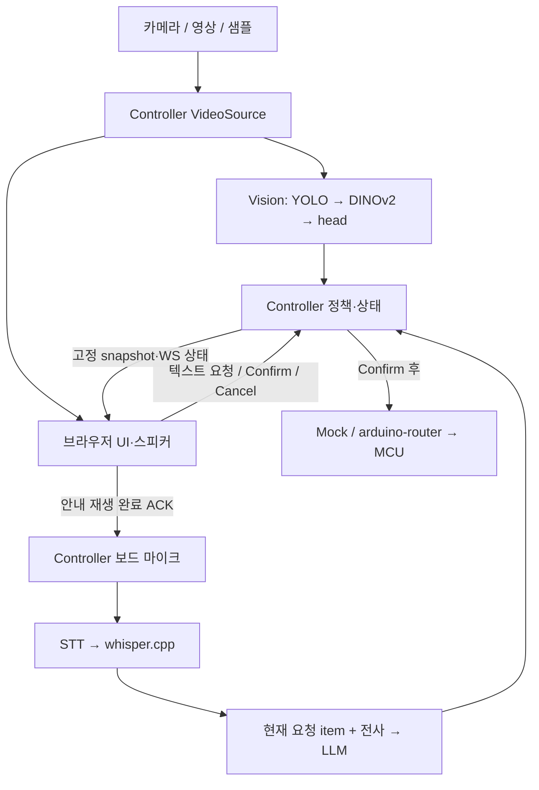

# 구조와 실행 경로

구현이 기준이며 이 문서는 진입점을 안내한다. 설정은 [`common/config.py`](../common/config.py), 타입은 [`common/contracts.py`](../common/contracts.py), HTTP 경로는 [`app/server.py`](../app/server.py)와 각 서비스 `server.py`에서 확인한다.

## 요청 흐름

1. [`media.py`](../app/media.py)가 단일 입력을 캡처한다. 수동 관찰 또는 [`capture.py`](../app/capture.py)의 안정성 판정으로 이미지와 Vision 결과를 고정한다. bbox는 이 snapshot에 표시한다.
2. [`controller.py`](../app/controller.py)가 신뢰도·잔량으로 대상을 고른다. 충분한 잔량·불확실 장면은 skip한다. 정책 임계값은 설정을 따른다.
3. 태블릿이 고정 WAV 안내를 끝내고 현재 session/scene/object/sequence로 ACK하면 보드가 녹음한다. STT 전사는 자동으로 LLM에 전달한다. 개발용 브라우저 녹음은 전사 검토 후 Send한다.
4. [`language.py`](../app/language.py)가 영어 system prompt와 `{current_request: {item}, utterance}`를 보낸다. 이미지·전체 Vision 결과·대화 이력은 LLM에 넣지 않는다. 첫 item은 관찰 대상에서, 수정은 현재 카드에서 가져온다.
5. LLM 결과는 `refill/decline/cancel/not_understood`와 item이다. refill만 카드를 만들고, 이해하지 못하면 재입력을 요청한다. 카드의 명시 Confirm 전에는 적재·복귀하지 않는다.

Controller는 lock·generation token·카드 revision으로 중복 확인과 취소 뒤 늦은 결과를 막는다. UI는 instance_id/sequence로 오래된 상태를 무시하고 WS 재연결 시 전체 상태를 받는다. 세션은 메모리에만 있다. 자동 캡처 진행 이벤트는 별도 revision을 쓰며 요청 sequence를 바꾸지 않는다.

## 모델 실행

| 서비스 | 실제 경로 | 수명 |
| --- | --- | --- |
| 보드 LLM | Qwen API → `BoardLLMBackend` → Gemma4 `qnn_llm_runner_host` | 서버 시작 preload, 같은 모델 worker 재사용, 요청마다 KV 초기화 |
| Vision | external factory → `VisionBackend` → YOLO/DINO runner → head | 시작 시 모델 로드. CLI bundle은 각각 상주 native worker 사용 |
| STT | external factory → `WhisperHTTP` → 외부 whisper.cpp | adapter 수명은 서비스와 같고 모델 서버는 별도 관리 |
| 개발 LLM | Controller 또는 Qwen proxy → Mac MLX HTTP | 원격 서버 소유 |

`QWEN_*`는 기존 서비스 경계 이름이며 보드의 실제 모델은 Gemma4다. `qwen_cli`는 별도 선택하는 일회성 Qwen runner다. 모델 실패 시 자동 fallback은 없다. LLM worker 오류는 다음 생성 요청에서 재로드할 수 있고, Vision worker 오류는 서비스 재시작으로 복구한다.

앱은 native Python/venv/FastAPI, 서비스별 Uvicorn worker 1개다. 학습·export 환경은 `ml/`에 분리한다. 보드 실행·프로세스 소유는 [runbook](BOARD_RUNBOOK.md), 연결 규칙은 [계약](CONTRACTS.md)을 따른다.

## 시각 카테고리와 요청 메뉴

DINO의 기존 softmax 출력에서 `coffee + coke → coke`, `water → water`로 확률을 합산한다.
대표 이름 `coke`는 관찰 그룹이며, 커피로 확정했다는 뜻이 아니다. 잔량 계산과 모델 가중치는 유지한다.
Controller는 frozen scene에 인식된 모든 그룹을 펼쳐 요청 가능한 `allowed_items`를 만든다.
예: coke만 보이면 coke/coffee, water만 보이면 water, 둘 다 보이면 water/coke/coffee.
이 목록은 LLM 제품 프롬프트와 UI 그림 선택지에 공통으로 사용하며, Controller가 LLM의
목록 밖 요청을 재확인 상태로 돌려 확인을 차단한다. Confirm은 여전히 별도로 필요하다.
Demo tools는 고정 매핑을 읽기 전용으로 표시한다. 구현 원본은 `common/vision_categories.py`다.

Demo tools의 **Enable untrained drink variants (demo only)** 는 기본 OFF다.
켜면 요청 메뉴만 water → water/sparkling water/soda, coke → coke/coke zero/coffee로 확장한다.
Vision 학습 클래스·확률·모델은 바꾸지 않으며, 추가 음료는 고객 발화로 선택한다.
API 식별자는 `sparkling_water`, `coke_zero`, 영어 UI는 공백으로 표시한다.
토글은 Controller 메모리에 유지되어 태블릿 재접속에 공유되고 서버 재시작 시 OFF로 돌아간다.
변경 시 요청 카드를 폐기해 재확인을 요구하며 추론·녹음·시퀀스 진행 중에는 변경을 거절한다.
